<h1 align="center">⚡ Utility Costs for Home Assistant</h1>

<p align="center">
  <b>Know what you really pay for electricity, gas and water – and when your PV, heat pump or EV pays for itself.</b>
</p>

<p align="center">
  <b>🇬🇧 English</b> · <a href="README.pl.md">🇵🇱 Polski</a>
</p>

<p align="center">
  <a href="https://hacs.xyz"></a>
  <a href="https://github.com/kakaki/ha-utility-costs/releases"></a>
  <a href="https://github.com/kakaki/ha-utility-costs/actions/workflows/validate.yml"></a>
  
  <a href="LICENSE"></a>
</p>

<p align="center">
  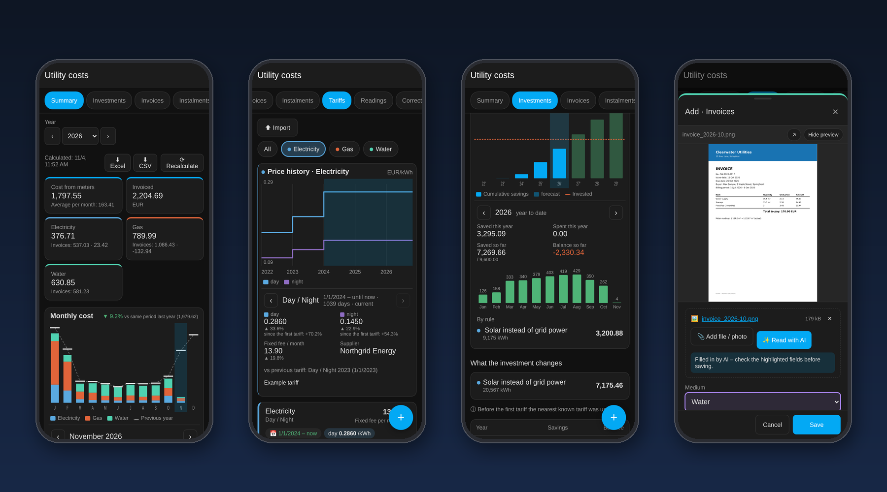
</p>

Home Assistant already knows **how much** you use. Your supplier knows **how much it costs**. Utility Costs
puts the two together: a register of invoices, tariffs and instalments that checks every bill against your
own meters, gives you a monthly cost for each medium, and works out the payback of investments that change
your energy bills.

> The screenshots show a fictional demo household. The panel follows your Home Assistant language (English, Polish, German) and currency.

## ✨ Highlights

- 🧾 **Invoices vs meters** – every bill is compared with what your meters recorded over exactly the same
  period. Over-estimated bills and meter faults show up straight away.
- 📈 **Real monthly cost** – the tariff valid on each day is used, so price changes in the middle of a billing
  period are counted exactly. Day/night zones (e.g. G12) are supported.
- 💰 **Investment payback** – PV, heat pump instead of gas, electric car instead of fuel, or anything you can
  describe with a meter and a price. Payback month, chart and forecast.
- ✨ **AI invoice reading** – snap a photo or drop a PDF and an `ai_task` entity (OpenAI, Google, Ollama…)
  fills in the form for you to review.
- 📥 **Excel / CSV** – export a year to Excel or CSV, import invoices, instalments, tariffs and purchases
  from a spreadsheet (template included).
- 🔔 **Notifications** – instalment reminders and alerts when an invoice differs from your meters.
- 🃏 **Dashboard card** – this month's cost and a forecast for the whole year.
- 📱 **Mobile-first panel** – cards, bottom-sheet editors, a settings wizard. No YAML, no JSON.
  Tabs you do not use (e.g. Instalments or Investments) can be hidden in Settings.
- 🔒 **Local** – everything is stored in your Home Assistant.

## 📊 Year summary

Monthly cost from meters next to the invoiced amount and the settlement balance for every medium.
Click a month in the chart to see the cost per medium, the same month last year and the invoices covering it.
Results are calculated in the background and cached; only a year whose data changed is recalculated,
the current month is kept up to date and a **Recalculate** button forces a full run.

<p align="center">
  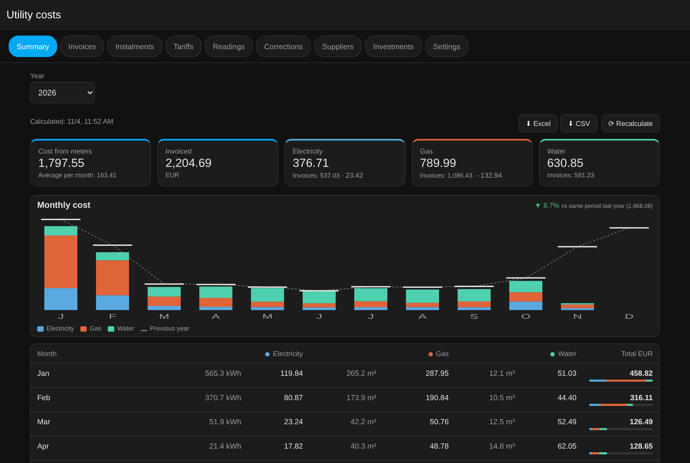
</p>
<p align="center">
  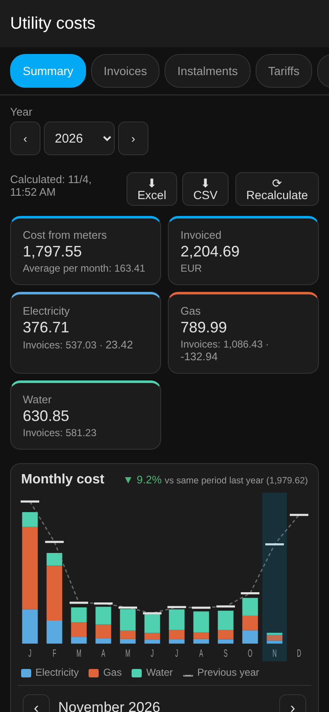
  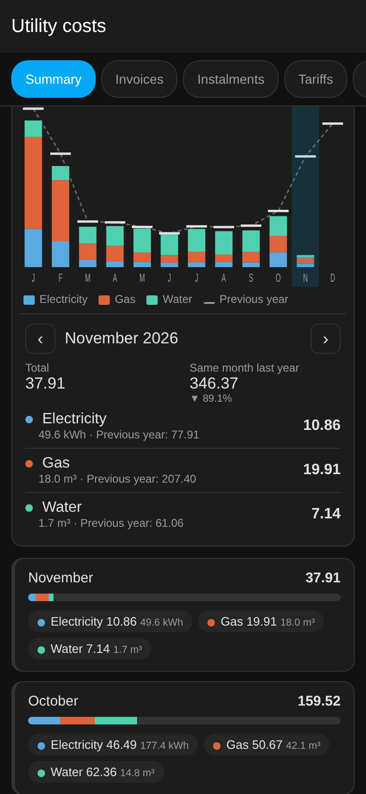
  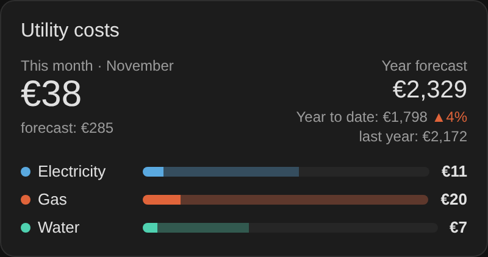
</p>

## 🧾 Invoices, instalments and tariffs

- Invoices of any kind: settlement, forecast, periodic, correction – with balance (overpayment / extra charge).
- Each invoice shows its deviation from the meters (`vs meters −12%`) and data coverage.
- Attach the PDF or a photo: the editor shows it next to the form, the list marks invoices with 📎 and the number of files.
- Instalments with due dates, a sensor for the next one.
- Tariffs over time: unit price per zone, fixed monthly fee, extra charges per unit or per month.
  Select a medium (chips above the list, several at once are allowed) to see a price-history chart; click a period for the details.
- Corrections for periods when a meter was broken or replaced.

<p align="center">
  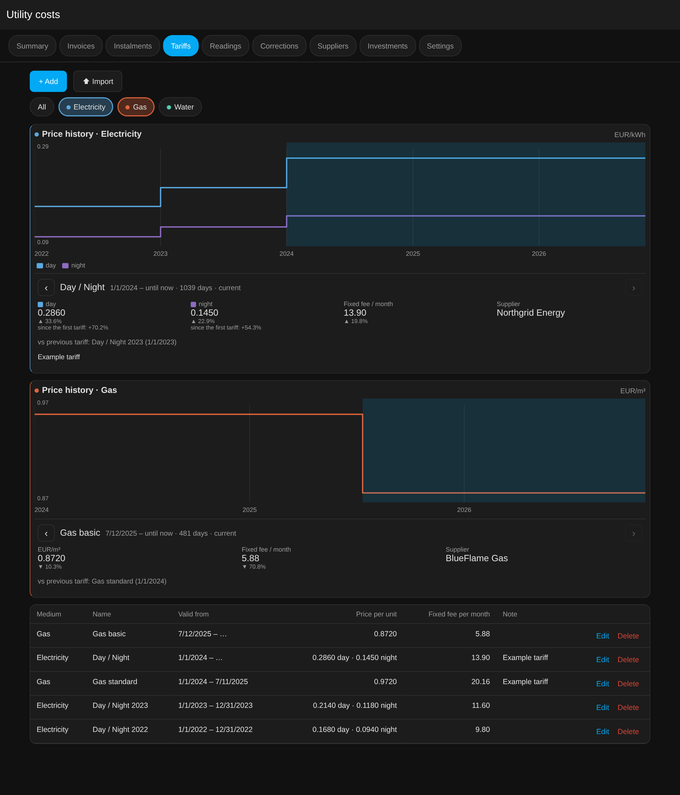
</p>
<p align="center">
  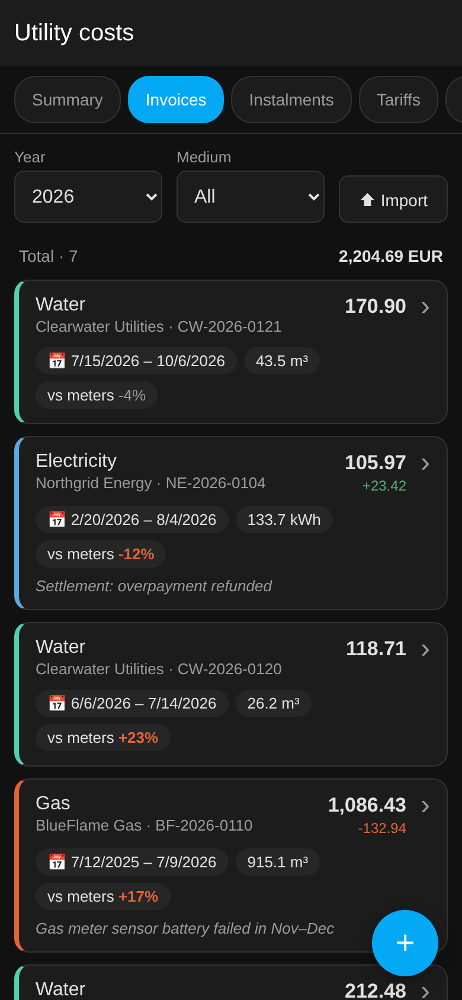
  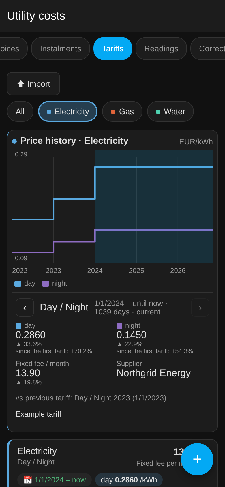
  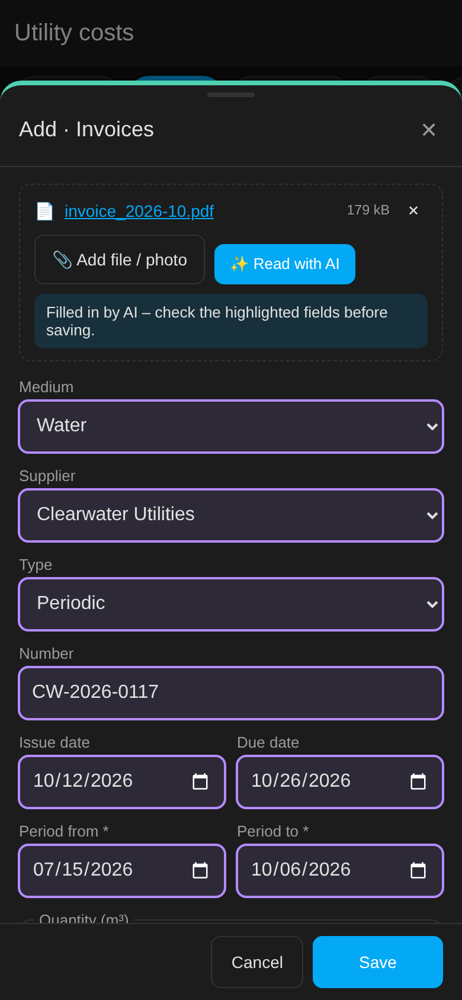
</p>

## 💰 Investments and payback

A project has expenses and rules describing what it changes:

| Rule | Example |
|---|---|
| **Quantity from a meter** – saving or extra cost, priced with the tariff of that day | PV production replaces grid electricity · heat-pump energy × factor replaces gas · EV charging replaces fuel |
| **Fixed fee** avoided or added | gas connection fee you no longer pay |
| **Amount per year** | subsidy, insurance, service |

Click a year in the payback chart to see its savings, expenses, balance and a monthly breakdown.
With more than one project, **All** (selected by default) adds them up on one chart, stacked per project, with a combined payback month.
Templates for **PV**, **heat pump instead of gas** and **electric car instead of fuel** get you started.
Periods without meter data are estimated with a seasonal profile; you can add a yearly price growth.

<p align="center">
  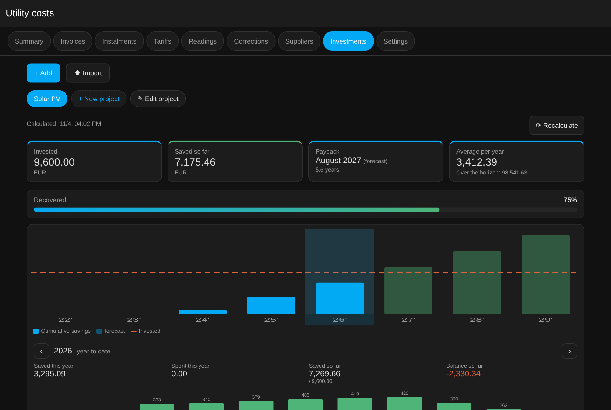
</p>
<p align="center">
  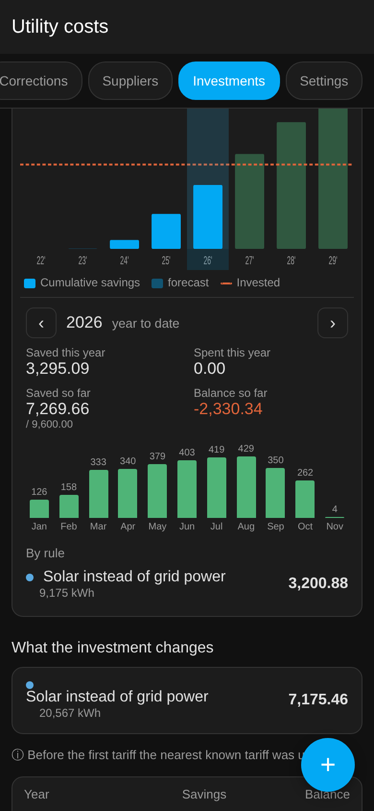
  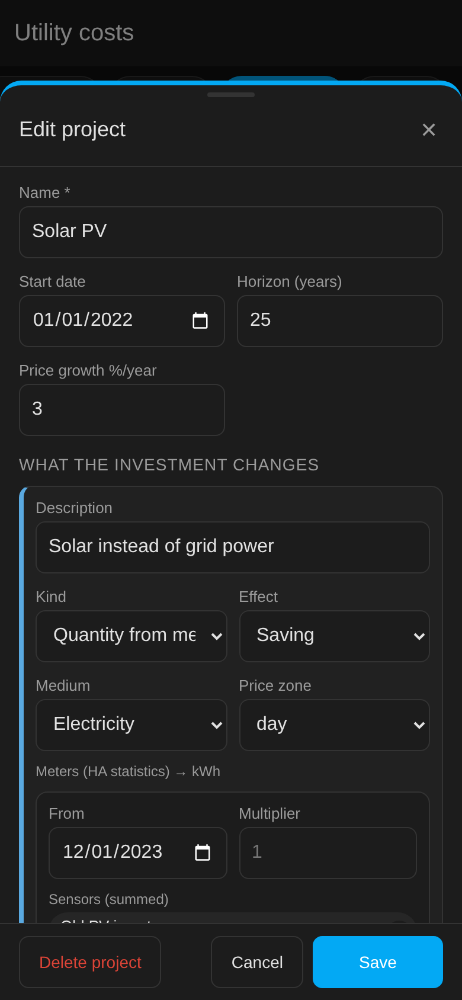
  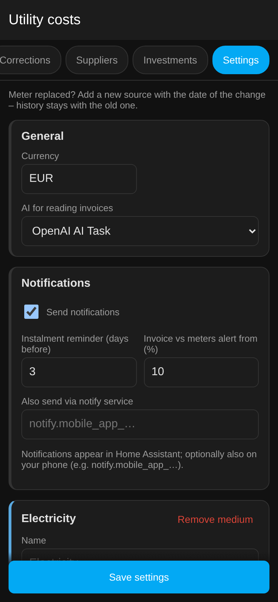
</p>

## 📥 Import and export

- **Export**: the summary tab has *Excel* (summary, invoices, instalments, tariffs on separate sheets) and *CSV* buttons.
- **Import**: on the Invoices, Instalments, Tariffs and Investments tabs press **Import**. The window lists the
  columns it understands (English, Polish or German names), shows an example and offers a template to download.
  You get a preview with errors and duplicates before anything is saved; unknown suppliers are created.

| medium | period_from | period_to | amount | quantity | supplier | number |
|---|---|---|---|---|---|---|
| gas | 2025-07-12 | 2026-07-09 | 1060.40 | 915 | BlueFlame Gas | BF-2026-0077 |
| electricity | 20.02.2026 | 04.08.2026 | 105,90 € | 163 | Northgrid Energy | NE-2026-0123 |

## 🃏 Dashboard card

The card is registered automatically – add it from the card picker or with YAML:

```yaml
type: custom:utility-costs-card
title: Utility costs   # optional
show_media: true       # bars per medium
show_year: true        # year forecast and comparison with last year
```

<p align="center"></p>

## 🔔 Notifications

Settings → *Notifications*: reminder N days before an instalment is due, alert when an invoice differs from the meters by
more than X %, optional `notify.*` service (e.g. the mobile app). Each event is sent once; existing invoices are not reported
when the feature is first enabled.

## 🔌 Sensors and services

- Sensors per medium: current price per zone, fixed fee, last settlement, next instalment.
- *Cost this month* and *Year forecast* (with per-medium attributes and last year for comparison).
- Optional sync of current prices to existing `input_number` helpers (useful for the Energy dashboard).
- Services (admin users and automations only): `utility_costs.add_invoice`, `utility_costs.import_file`
  (JSON file inside the configuration folder), `utility_costs.export`.

## 📦 Installation

### Marketplace / HACS (recommended)

[](https://my.home-assistant.io/redirect/hacs_repository/?owner=kakaki&repository=ha-utility-costs&category=integration)

1. **Settings → Marketplace** (Home Assistant 2026.11+) or **HACS** on older versions: search for **Utility Costs** and install it.
   On older HACS versions restart Home Assistant afterwards.
2. **Settings → Devices & services → Add integration → Utility Costs**.

If the search does not find it yet, add it as a custom repository: ⋮ → **Custom repositories** →
`https://github.com/kakaki/ha-utility-costs`, type **Integration**, and install it from there.

### Manual

Copy `custom_components/utility_costs` to `<config>/custom_components/` and restart Home Assistant.

## 🚀 Getting started

1. Open **Utility costs** in the sidebar → **Settings**: the wizard asks for your media, zones and meters
   (sensors with long-term statistics).
2. **Tariffs** – add prices with their validity dates.
3. **Invoices** – type them in, or attach a photo/PDF and press **Read with AI**.
4. **Investments** – create a project from a template and pick the meters.

## Requirements

- Home Assistant **2025.8** or newer (2026.3+ shows the integration icon).
- Meters with long-term statistics (`state_class: total` or `total_increasing`).
- AI reading needs an `ai_task` entity. It can be switched off in Settings.

## 🔒 Privacy

Data is stored in `.storage/utility_costs*`, attachments in `/media/utility_costs/`.
Nothing leaves your Home Assistant unless you use AI reading – then only the invoice file is sent to the AI
provider you selected.

## Contributing

Issues and pull requests are welcome. Sample invoices (with personal data removed) from different suppliers and
countries help to improve AI reading.

---

## 🇵🇱 Po polsku

Pełny opis po polsku, z polskimi zrzutami ekranu: **[README.pl.md](README.pl.md)**.

## License

[MIT](LICENSE)
