<h1 align="center">⚡ Koszty mediów dla Home Assistant</h1>

<p align="center">
  <b>Dowiedz się, ile naprawdę płacisz za prąd, gaz i wodę – i kiedy zwróci się fotowoltaika, pompa ciepła albo auto elektryczne.</b>
</p>

<p align="center">
  <a href="https://github.com/kakaki/ha-utility-costs/blob/main/README.md">🇬🇧 English</a> · <b>🇵🇱 Polski</b>
</p>

<p align="center">
  <a href="https://hacs.xyz"></a>
  <a href="https://github.com/kakaki/ha-utility-costs/releases"></a>
  <a href="https://github.com/kakaki/ha-utility-costs/actions/workflows/validate.yml"></a>
  
  <a href="https://github.com/kakaki/ha-utility-costs/blob/main/LICENSE"></a>
</p>

<p align="center">
  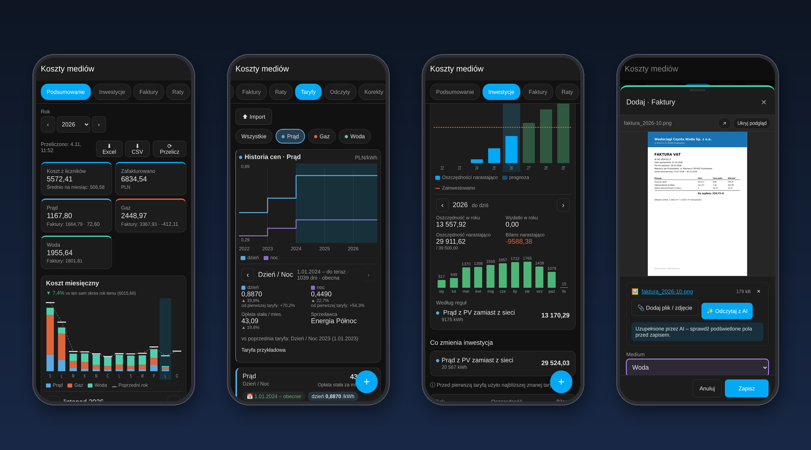
</p>

Home Assistant wie, **ile** zużywasz. Twój sprzedawca wie, **ile to kosztuje**. Koszty mediów łączą jedno
z drugim: to rejestr faktur, taryf i rat, który sprawdza każdy rachunek z Twoimi własnymi licznikami, podaje
miesięczny koszt każdego medium i wylicza zwrot inwestycji, które zmieniają Twoje rachunki za energię.

> Zrzuty ekranu pokazują fikcyjne, przykładowe gospodarstwo domowe (nazwy sprzedawców i kwoty są zmyślone).
> Panel używa języka i waluty ustawionych w Home Assistant: polskiego, angielskiego lub niemieckiego.

## ✨ Najważniejsze funkcje

- 🧾 **Faktury kontra liczniki** – każda faktura jest porównywana z tym, co zarejestrowały Twoje liczniki
  w dokładnie tym samym okresie. Zawyżone prognozy i awarie liczników widać od razu.
- 📈 **Rzeczywisty koszt miesięczny** – dla każdego dnia używana jest taryfa, która wtedy obowiązywała, więc
  zmiana ceny w środku okresu rozliczeniowego jest liczona dokładnie. Obsługiwane są strefy dzień/noc (np. G12).
- 💰 **Zwrot z inwestycji** – fotowoltaika, pompa ciepła zamiast gazu, auto elektryczne zamiast paliwa albo
  cokolwiek, co da się opisać licznikiem i ceną. Miesiąc zwrotu, wykres i prognoza.
- ✨ **Odczyt faktur przez AI** – zrób zdjęcie albo wrzuć PDF, a encja `ai_task` (OpenAI, Google, Ollama…)
  wypełni formularz, który tylko sprawdzasz.
- 📥 **Excel / CSV** – eksport roku do Excela lub CSV, import faktur, rat, taryf i zakupów inwestycyjnych
  z arkusza (szablon w zestawie).
- 🔔 **Powiadomienia** – przypomnienia o ratach i alerty, gdy faktura odbiega od liczników.
- 🃏 **Karta na dashboard** – koszt bieżącego miesiąca i prognoza na cały rok.
- 📱 **Panel projektowany pod telefon** – karty, edytory wysuwane od dołu, kreator ustawień. Bez YAML i JSON.
  Nieużywane zakładki (np. Raty albo Inwestycje) można ukryć w Ustawieniach.
- 🔒 **Lokalnie** – wszystko jest zapisywane w Twoim Home Assistant.

## 📊 Podsumowanie roku

Miesięczny koszt z liczników obok kwot z faktur i salda rozliczeń dla każdego medium.

- Wykres miesięczny jest klikalny: kliknij (albo najedź / wybierz klawiaturą) miesiąc, a pod wykresem pojawi się
  koszt i zużycie każdego medium, ten sam miesiąc rok wcześniej ze zmianą procentową oraz faktury obejmujące
  ten miesiąc. Strzałkami ‹ › przechodzisz między miesiącami.
- Rok wybierasz z listy albo strzałkami ‹ › obok niej.
- Kafelki pokazują koszt z liczników, kwotę zafakturowaną i saldo każdego medium; wynik porównujesz z tym samym
  okresem poprzedniego roku.
- Wyniki są liczone w tle i zapamiętywane; przeliczany jest tylko rok, w którym zmieniły się dane, bieżący
  miesiąc jest aktualizowany na bieżąco, a przycisk **Przelicz** wymusza pełne przeliczenie.

<p align="center">
  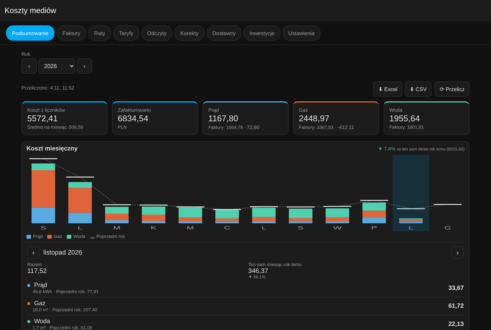
</p>
<p align="center">
  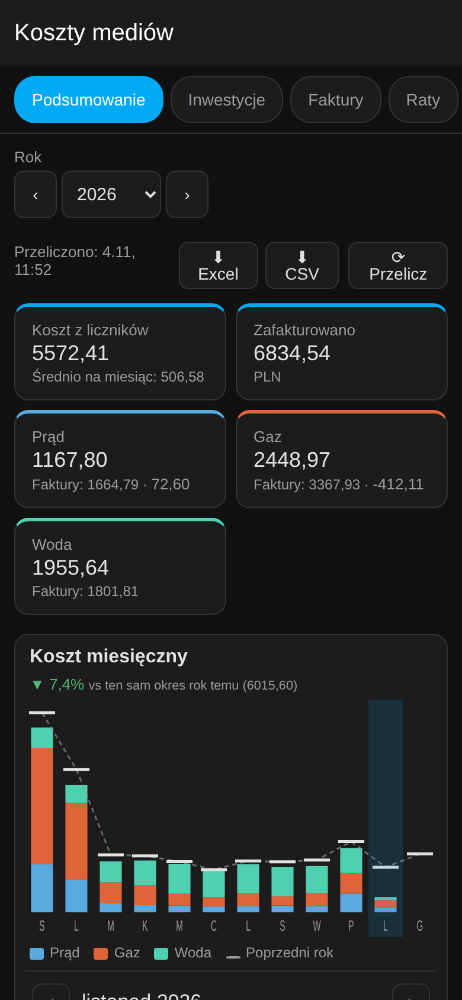
  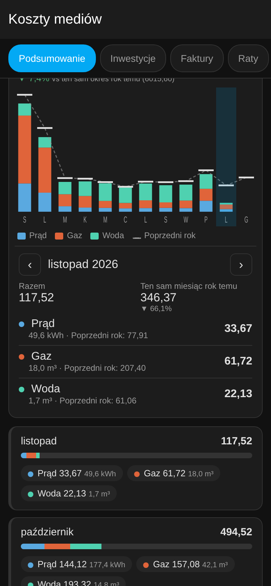
  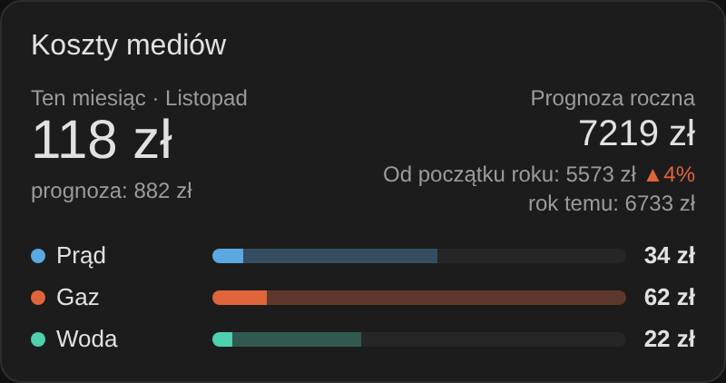
</p>

## 🧾 Faktury, raty i taryfy

- **Faktury** każdego rodzaju: rozliczeniowe, prognozowe, okresowe, korekty – z saldem (nadpłata / niedopłata).
- Każda faktura pokazuje odchylenie od liczników (`vs liczniki −12%`) i pokrycie danymi.
- **Załączniki**: dołącz PDF albo zdjęcie faktury. Edytor pokazuje podgląd obok formularza (na telefonie nad
  nim, można go ukryć), a lista oznacza faktury ikoną 📎 z liczbą plików.
- **Raty** z terminami płatności i sensorem następnej raty.
- **Taryfy** w czasie: cena jednostkowa w każdej strefie, opłata stała miesięczna, dodatkowe opłaty za jednostkę
  lub za miesiąc.
- **Wykres historii cen**: na karcie Taryfy wybierz medium, a jeśli ma więcej niż jedną taryfę, zobaczysz
  wykres zmian ceny w czasie (osobna linia dla każdej strefy). Kliknij okres, żeby zobaczyć szczegóły taryfy:
  ceny ze zmianą względem poprzedniej i pierwszej taryfy, opłatę stałą, sprzedawcę i notatkę.
- **Filtr mediów jako przyciski (chipy)** nad listą, na każdej karcie: możesz zaznaczyć jedno albo kilka mediów
  naraz, **Wszystkie** czyści filtr.
- **Korekty** dla okresów, gdy licznik był zepsuty lub wymieniony.
- **Podział zużycia** – opcjonalne liczniki pokazujące, na co idzie medium (gaz na ogrzewanie i na ciepłą wodę, prąd na auto…). Kafelki roku i szczegóły miesiąca pokazują każdą część z jej udziałem w koszcie. Ustawisz to w Ustawieniach → *Podział zużycia*.

<p align="center">
  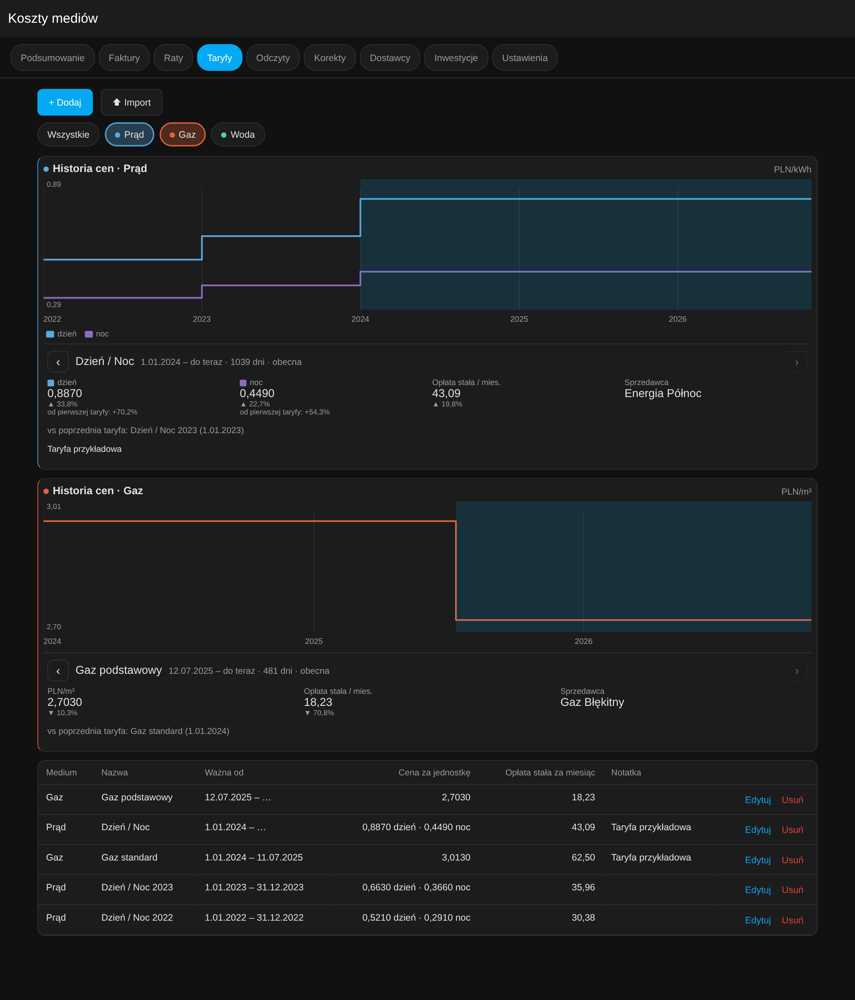
</p>
<p align="center">
  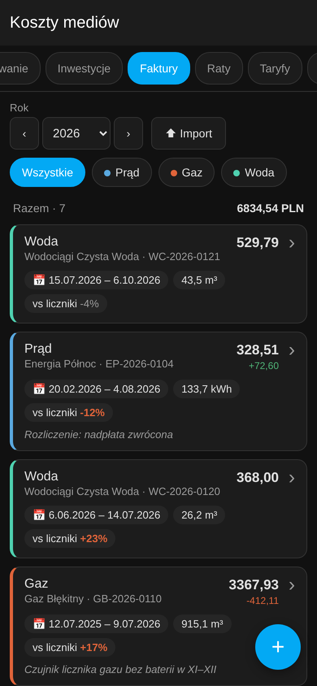
  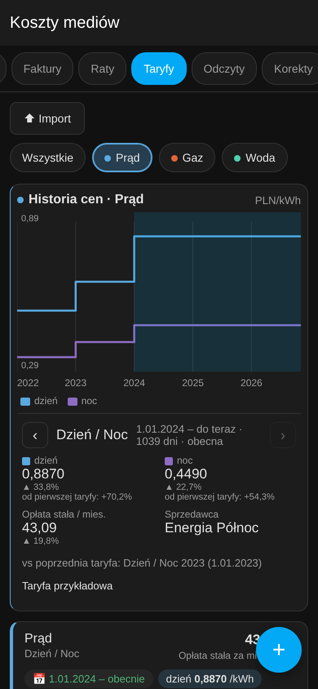
  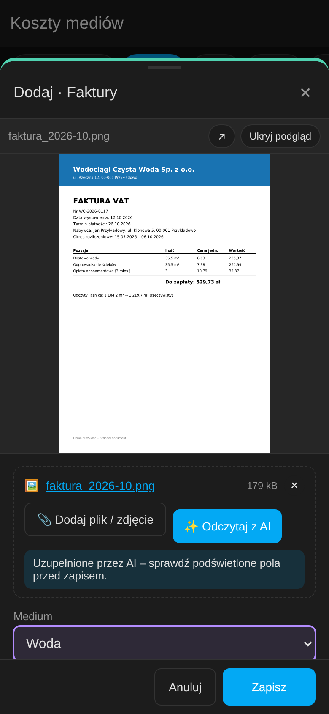
</p>

## 💰 Inwestycje i zwrot

Projekt ma wydatki i reguły opisujące, co zmienia:

| Reguła | Przykład |
|---|---|
| **Ilość z licznika** – oszczędność lub dodatkowy koszt, wyceniane taryfą z danego dnia | produkcja PV zastępuje prąd z sieci · energia pompy ciepła × mnożnik zastępuje gaz · ładowanie auta zastępuje paliwo |
| **Opłata stała** unikana lub dodatkowa | opłata za przyłącze gazowe, której już nie płacisz |
| **Kwota na rok** | dotacja, ubezpieczenie, serwis |
| **Symulacja pompy ciepła** – część ciepła z kotła przeniesiona na klimatyzatory / pompy ciepła | gaz na ogrzewanie × 85% → prąd według COP przy temperaturze zewnętrznej danego dnia, osobno dla każdego urządzenia (moc, SCOP, minimalna temperatura pracy) |

- Wykres zwrotu jest klikalny: kliknij rok, żeby zobaczyć oszczędność i wydatki z tego roku, skumulowaną
  oszczędność wobec zainwestowanej kwoty, bilans, rozbicie na miesiące, sumy dla każdej reguły i wydatki
  zaksięgowane w tym roku. Wiersze tabeli lat też wybierają rok.
- Przy kilku projektach przełącznik **Wszystkie** (pierwszy i domyślnie zaznaczony) sumuje je na jednym
  wykresie: wydatki, oszczędności, wspólny miesiąc zwrotu i średnią roczną, a słupki oszczędności są podzielone
  kolorami na projekty. Szczegóły roku pokazują podział na projekty i reguły, a lista wydatków – projekt każdego zakupu.
- Szablony **Fotowoltaika**, **Pompa ciepła zamiast gazu** i **Auto elektryczne zamiast paliwa** pozwalają
  szybko zacząć.
- Szablon **Pompa ciepła zamiast gazu** to symulacja „co by było, gdyby”: na podstawie gazu zużytego na
  ogrzewanie (część z podziału zużycia) i czujnika temperatury zewnętrznej liczy dzień po dniu, ile dałoby
  przeniesienie np. 85% ogrzewania na klimatyzatory – niespalony gaz minus prąd dla pomp, wyceniony taryfami
  z udziałem stref (np. głównie noc przy magazynie energii). Dni bez odczytu temperatury używają typowych
  temperatur miesięcznych, które można poprawić.
- Okresy bez danych z liczników są szacowane profilem sezonowym; można dodać roczny wzrost cen.
- Dla auta elektrycznego można użyć licznika kilometrów i zużycia z komputera auta (np. 15 kWh/100 km zamiast
  7 l/100 km), a sesje z szybkich ładowarek dopisać jako wydatki.

<p align="center">
  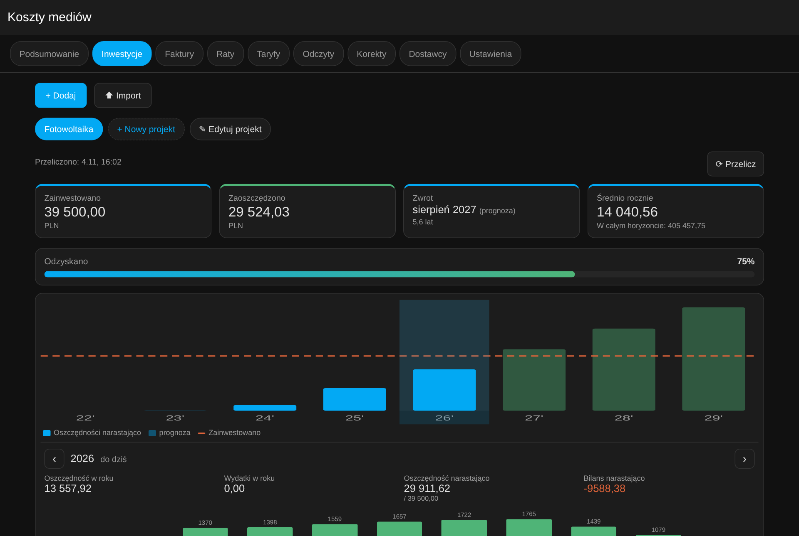
</p>
<p align="center">
  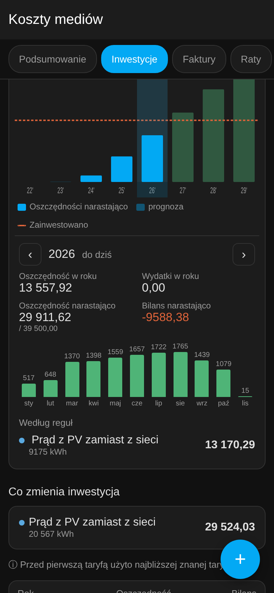
  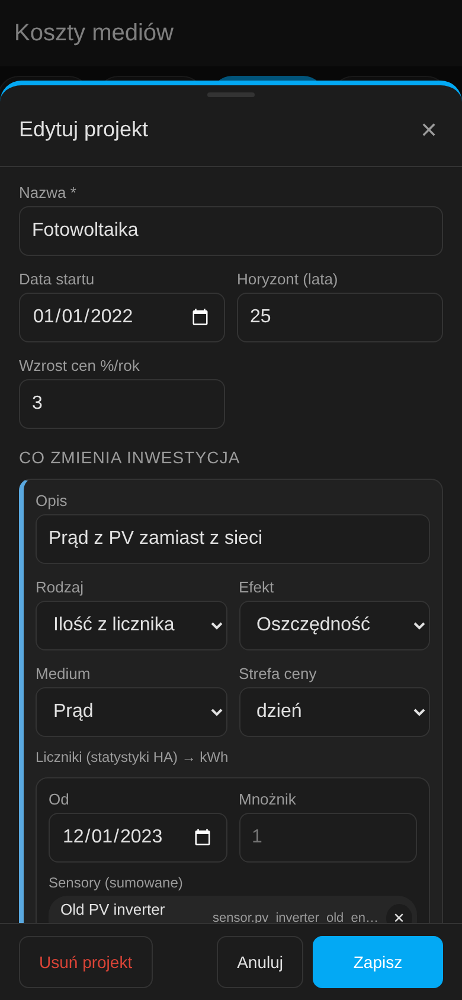
  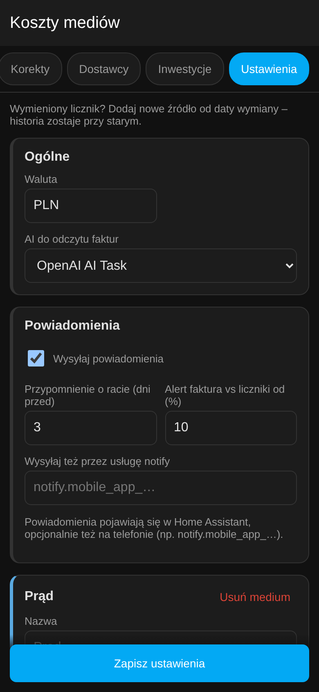
</p>

## 📥 Import i eksport

- **Eksport**: na karcie Podsumowanie są przyciski *Excel* (podsumowanie, faktury, raty i taryfy w osobnych
  arkuszach) oraz *CSV*.
- **Import**: na kartach Faktury, Raty, Taryfy i Inwestycje naciśnij **Import**. Okno pokazuje kolumny, które
  rozumie (nazwy polskie, angielskie lub niemieckie), przykład i szablon do pobrania. Przed zapisem dostajesz
  podgląd z błędami i duplikatami; nieznani sprzedawcy są dodawani automatycznie.
- Daty: `2026-03-31`, `31.03.2026` albo daty Excela; kwoty mogą mieć przecinek i walutę (`1 234,56 zł`).

| medium | okres od | okres do | kwota | ilość | dostawca | numer |
|---|---|---|---|---|---|---|
| gaz | 2025-07-12 | 2026-07-09 | 3290,40 | 915 | Gaz Błękitny | GB-2026-0077 |
| prąd | 20.02.2026 | 04.08.2026 | 328,51 zł | 134 | Energia Północ | EP-2026-0123 |

## 🃏 Karta na dashboard

Karta rejestruje się sama – dodaj ją z listy kart albo w YAML:

```yaml
type: custom:utility-costs-card
title: Koszty mediów   # opcjonalnie
show_media: true       # paski dla każdego medium
show_year: true        # prognoza roczna i porównanie z poprzednim rokiem
```

<p align="center"></p>

## 🔔 Powiadomienia

Ustawienia → *Powiadomienia*: przypomnienie N dni przed terminem raty, alert, gdy faktura odbiega od liczników
o więcej niż X %, opcjonalnie wysyłka przez usługę `notify.*` (np. aplikację mobilną). Każde zdarzenie jest
wysyłane raz; po pierwszym włączeniu istniejące faktury nie są zgłaszane.

## 🔌 Sensory i usługi

- Sensory dla każdego medium: aktualna cena w każdej strefie, opłata stała, ostatnie rozliczenie, następna rata.
- *Koszt w tym miesiącu* i *Prognoza roczna* (z atrybutami dla każdego medium i poprzednim rokiem do porównania).
- Opcjonalna synchronizacja aktualnych cen do istniejących pomocników `input_number` (przydatne w panelu Energia).
- Usługi (tylko dla administratorów i automatyzacji): `utility_costs.add_invoice`, `utility_costs.import_file`
  (plik JSON w folderze konfiguracji), `utility_costs.export`.

## 📦 Instalacja

### Marketplace / HACS (zalecane)

[](https://my.home-assistant.io/redirect/hacs_repository/?owner=kakaki&repository=ha-utility-costs&category=integration)

1. **Ustawienia → Marketplace** (Home Assistant 2026.11+) albo **HACS** w starszych wersjach: wyszukaj **Utility Costs**
   i zainstaluj. W starszym HACS uruchom potem ponownie Home Assistant.
2. **Ustawienia → Urządzenia oraz usługi → Dodaj integrację → Koszty mediów**.

Jeśli wyszukiwarka jeszcze go nie znajduje, dodaj go jako repozytorium niestandardowe: ⋮ → **Niestandardowe repozytoria** →
`https://github.com/kakaki/ha-utility-costs`, typ **Integracja**, i zainstaluj stamtąd.

### Ręcznie

Skopiuj `custom_components/utility_costs` do `<config>/custom_components/` i uruchom ponownie Home Assistant.

## 🚀 Pierwsze kroki

1. Otwórz **Koszty mediów** w menu bocznym → **Ustawienia**: kreator zapyta o media, strefy i liczniki
   (sensory ze statystykami długoterminowymi).
2. **Taryfy** – dodaj ceny z datami obowiązywania.
3. **Faktury** – wpisz je ręcznie albo dołącz zdjęcie/PDF i naciśnij **Odczytaj z AI**.
4. **Inwestycje** – utwórz projekt z szablonu i wskaż liczniki.

## Wymagania

- Home Assistant **2025.8** lub nowszy (od 2026.3 widać ikonę integracji).
- Liczniki ze statystykami długoterminowymi (`state_class: total` lub `total_increasing`).
- Odczyt przez AI wymaga encji `ai_task`. Można go wyłączyć w ustawieniach.

## 🔒 Prywatność

Dane są zapisywane w `.storage/utility_costs*`, załączniki w `/media/utility_costs/`.
Nic nie opuszcza Twojego Home Assistant, chyba że używasz odczytu przez AI – wtedy tylko plik faktury jest
wysyłany do wybranego dostawcy AI.

## Współpraca

Zgłoszenia i pull requesty są mile widziane. Przykładowe faktury (z usuniętymi danymi osobowymi) od różnych
sprzedawców i z różnych krajów pomagają ulepszać odczyt przez AI.

## Licencja

[MIT](https://github.com/kakaki/ha-utility-costs/blob/main/LICENSE)
