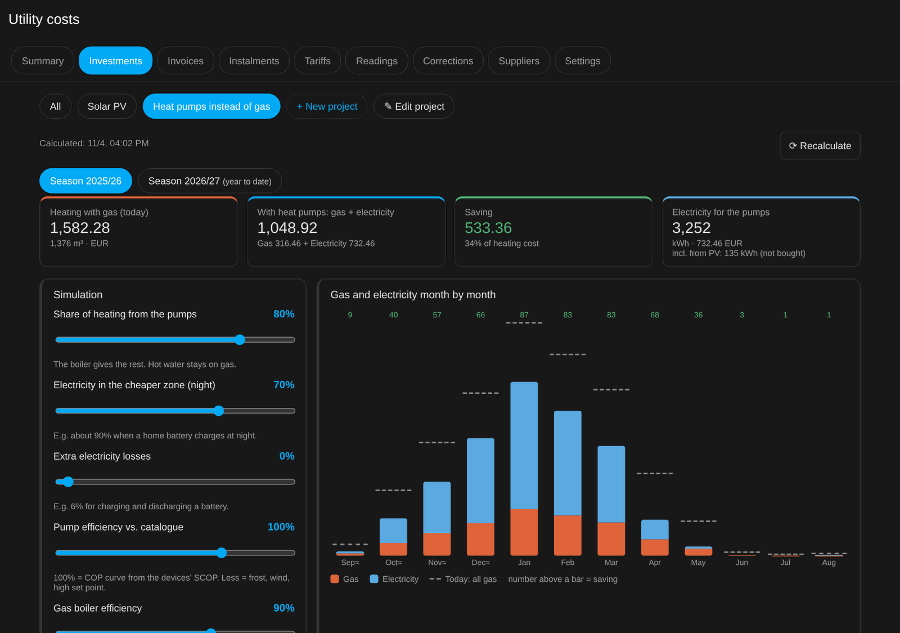
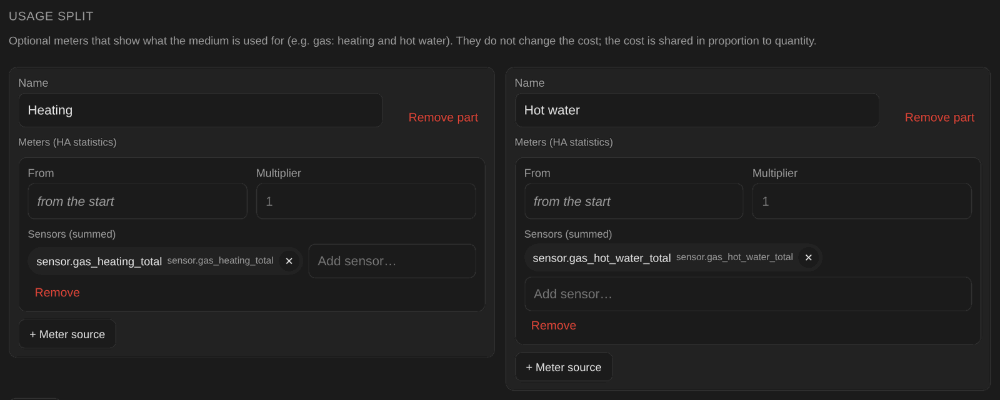
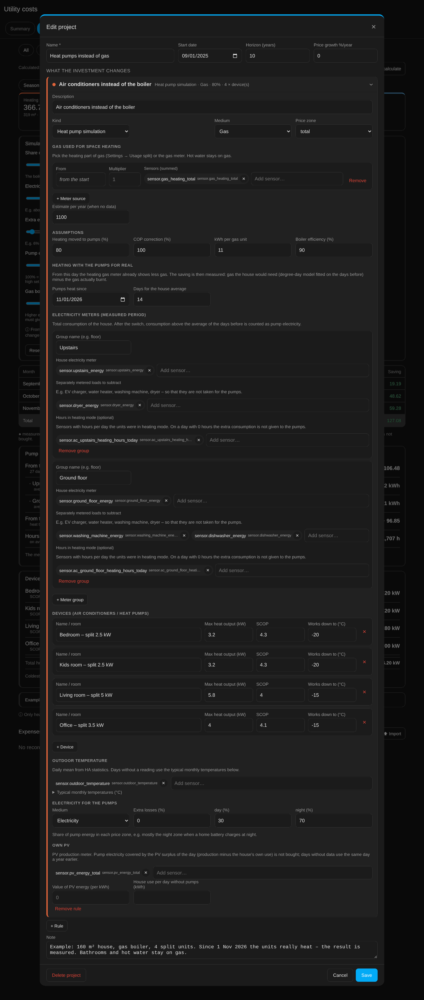
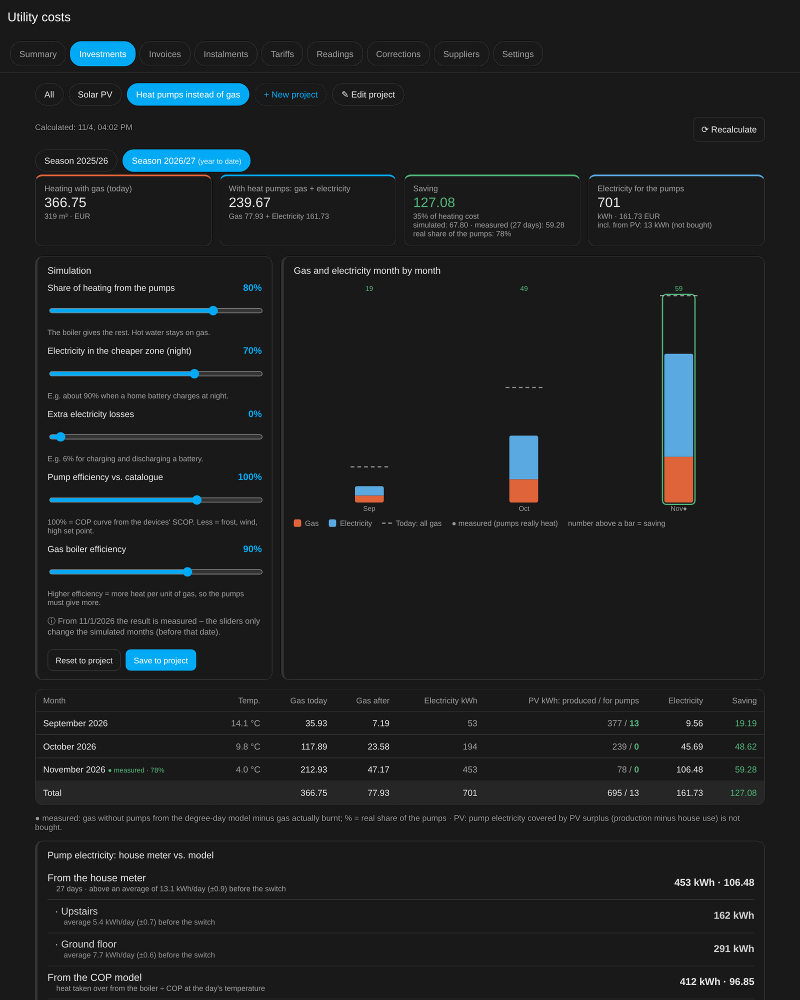
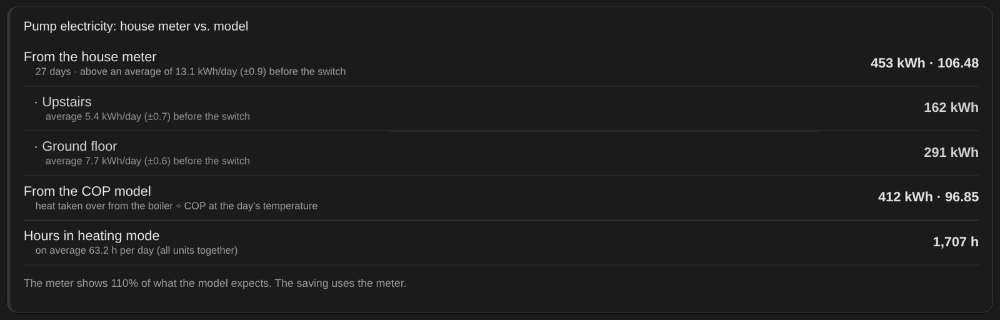
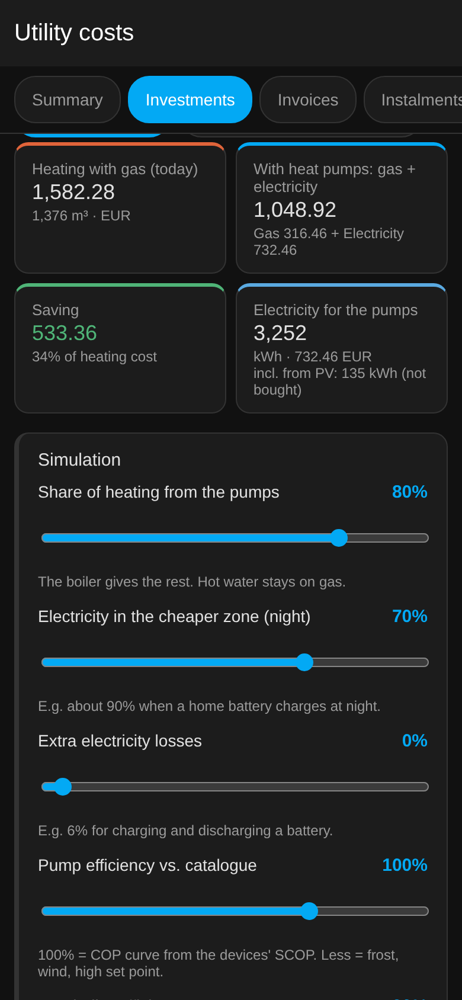

# Simulation: heat pumps / air conditioners instead of a gas boiler

[Wersja polska](pl/symulacja-pompy-ciepla.md) · [← README](../README.md)

This guide walks through the whole setup, from the sensors in Home Assistant to the finished view in the
**Investments** tab. All sensor names and numbers come from a **fictional example house**. Replace them with your own.

<p align="center"></p>

## What it calculates

The question is: *how much would I save if air-to-air heat pumps or split air conditioners took over part of the
heat that the gas boiler gives today?*

The simulation works day by day:

1. **Boiler heat** = heating gas × kWh per m³ (e.g. 11) × boiler efficiency (e.g. 90 %).
2. The chosen **share** of that heat (e.g. 80 %) is moved to the devices, each in proportion to its power.
   A device stops below its lowest working temperature (e.g. −15 °C), and one device cannot give more than its
   power × 24 h.
3. **Electricity** = heat taken over ÷ COP. COP depends on that day's outdoor temperature and the device's SCOP.
4. **Result** = gas not burnt × gas price − electricity × electricity price. The electricity price follows the
   share per tariff zone, e.g. 70 % night and 30 % day.

5. **Own PV (optional):** pump electricity covered by the PV surplus is not bought. The surplus is the day's
   production minus the house's own use without the pumps. Days without PV data use the same day a year earlier
   (marked ↺ in the table).

Hot water and the gas fixed fee stay the same, because the boiler still heats water.

After the **"Pumps heat since"** date the result is no longer simulated but **measured**:

- *gas without pumps* comes from a degree-day model fitted on the days before that date:
  `gas/day = k × max(0, 15 °C − T)`;
- *gas saved* is that value minus the gas actually burnt (heating meter);
- *pump electricity* comes from the house meter: consumption above the average before the switch, minus separately
  metered loads. Without a house meter the COP model is used.

## What you need

| # | Data | Why | Required? |
|---|---|---|---|
| A | Gas used **for space heating** (`total_increasing` meter, m³) | basis of everything | yes (or the total gas meter + an estimate) |
| B | Outdoor temperature (`state_class: measurement`, °C) | COP and the degree-day model | recommended |
| C | Gas and electricity tariffs in the **Tariffs** tab | prices | yes |
| D | House electricity meter, ideally per floor (`total_increasing`, kWh) | measured pump electricity | optional |
| E | Meters of loads to subtract: washing machine, dryer, dishwasher… | less noise | optional |
| F | Hours per day each unit is in heating mode | a day without heating = no pump electricity | optional |
| G | PV production meter (`total_increasing`, kWh) | part of the pump electricity for free | optional |

The integration reads **long-term statistics** only. A sensor without `state_class` never gets them, and the
recorder keeps plain history for only a few days. That is why every sensor below sets `state_class`.

---

## Step A: gas for heating and for hot water

Already have a separate heating gas meter? Skip this step. Otherwise, split the total meter by what the boiler is
doing at that moment. Most boiler integrations (OpenTherm, ems-esp, ebusd, Viessmann, De Dietrich…) expose a status
or operating mode.

In the example house:

- `sensor.gas_meter`: gas meter in m³, steps of 0.01 m³;
- `sensor.boiler_status`: boiler status with the states `heating`, `hot_water` and `idle`.

Add to `configuration.yaml` (or to a file included as `template: !include template.yaml`):

```yaml
template:
  # Last active boiler mode, needed when gas is counted before the status changes
  - trigger:
      - trigger: state
        entity_id: sensor.boiler_status
        not_to: [unavailable, unknown]
    sensor:
      - name: Boiler last active mode
        unique_id: boiler_last_active_mode
        state: >
          
          heatinghot_water{{ this.state }}

  # Every step of the gas meter goes to heating or to hot water
  - trigger:
      - trigger: state
        entity_id: sensor.gas_meter
        not_to: [unavailable, unknown]
        not_from: [unavailable, unknown]
    sensor:
      - name: Gas heating total
        unique_id: gas_heating_total
        unit_of_measurement: "m³"
        device_class: gas
        state_class: total_increasing
        state: >
          
          
          
          {{ (this.state|float(0) + (d if 0 < d < 1 and mode == 'heating' else 0))|round(3) }}
      - name: Gas hot water total
        unique_id: gas_hot_water_total
        unit_of_measurement: "m³"
        device_class: gas
        state_class: total_increasing
        state: >
          
          
          
          {{ (this.state|float(0) + (d if 0 < d < 1 and mode == 'hot_water' else 0))|round(3) }}
```

- **Other boiler states:** if your boiler reports e.g. `3:Heating` / `4:Hot water`, use `s.startswith('3')` and
  `s.startswith('4')` instead.
- **The `0 < d < 1` filter** skips meter swaps and restarts.
- **After saving:** **Developer tools → YAML → Template entities: reload**. No restart is needed.

Then in **Utility costs → Settings → Gas → Usage split** add two parts:

<p align="center"></p>

New sensors have no history. Days before they existed are taken from **Estimate per year (when no data)**, spread
by degree days. Enter the heating gas of your last bill, e.g. 1100 m³.

## Step B: outdoor temperature

Any sensor with `device_class: temperature` and `state_class: measurement` works: a weather station, the boiler's
outdoor probe or a Zigbee sensor outside. In the example house it is `sensor.outdoor_temperature`.

Days without a reading, e.g. before the sensor existed, use **typical monthly temperatures**. The default is
southern Poland 1991–2020, and you can enter your own in the rule.

## Step C: tariffs

The **Tariffs** tab needs gas and electricity tariffs for the whole project period. If electricity has zones, e.g.
day and night, the rule says which share of the pump energy falls into each.

## Steps D–F: measuring after the switch (optional)

Skip these if you only want a simulation. When you really start heating with the pumps, set them up, **ideally two
weeks before**, so there is an average of the house consumption before the switch.

**D: house meter.** Any `total_increasing` energy meter in kWh: a Shelly EM on a floor's supply, an inverter output
meter or a Shelly 3EM. If you have per-floor meters, use them as separate **groups**. Each group then has its own
average and its own heating hours, so laundry downstairs is not taken for the unit upstairs. Example house:

| Group | Meter | Subtracted | Heating hours |
|---|---|---|---|
| Upstairs | `sensor.upstairs_energy` | `sensor.dryer_energy` | `sensor.ac_upstairs_heating_hours_today` |
| Ground floor | `sensor.ground_floor_energy` | `sensor.washing_machine_energy`, `sensor.dishwasher_energy` | `sensor.ac_ground_floor_heating_hours_today` |

**E: loads to subtract.** Energy meters of appliances that swing a lot from day to day: washing machine, dryer,
dishwasher, water heater. A fridge does not need subtracting. Subtract only what is **really behind** the group's
meter. For example, an EV charger fed straight from the grid, outside the house meter, must **not** be subtracted.

**F: hours in heating mode.** For each unit create a **History stats** helper
(*Settings → Devices & services → Helpers → Create helper → History stats*):

| Field | Value |
|---|---|
| Entity | `climate.living_room_ac` |
| State | `heat` |
| Type | Time |
| Start | `{{ today_at() }}` |
| End | `{{ now() }}` |

History stats helpers **do not keep long-term statistics**. So sum the hours per group in a **template helper**
(*Helpers → Template → Sensor*):

| Field | Value |
|---|---|
| State | `{{ (['sensor.living_room_ac_heating_today', 'sensor.office_ac_heating_today'] \| map('states') \| map('float', 0) \| sum) \| round(2) }}` |
| Unit | `h` |
| Device class | Duration |
| State class | **Measurement** |

The integration takes the **daily maximum**, which is the hours of that day. `heat` means the selected mode, not
that the compressor runs all the time. That is why the hours are only a filter: on a day with 0 hours, extra
consumption is not given to the pumps.

**Only complete days are measured.** The current day joins the measurement the next day. The switch day is mixed
(boiler in the morning, pumps in the evening), so use the next day as the switch date. The real share of the pumps
is shown from 3 complete measured days.

## Step PV: own photovoltaics (optional)

Pick the PV production meter, e.g. `sensor.pv_energy_total` (`total_increasing`, kWh). For each day:

- PV surplus = production − the house's use without the pumps. The use comes from the group meters of step D,
  or from **House use per day without pumps** when there are none;
- pump electricity up to the surplus is not bought. **Value of PV energy** prices it: 0 means free energy, and
  enter a price if you could sell the surplus instead.

In winter there is usually no surplus, because PV produces little and the house uses its own share. PV matters
mainly in September, October, March and April. The monthly table shows PV production and how much of it went to
the pumps.

---

## Step G: the project in the panel

**Utility costs → Investments → + New project → template "Heat pump instead of gas".**
The template links the "Heating" gas part and an outdoor temperature sensor when it finds them. Fill in the rest:

<p align="center"></p>

| Field | Example house | Notes |
|---|---|---|
| Start date | 2025-09-01 | first season you want to see |
| Gas used for space heating | `sensor.gas_heating_total` | "Heating" part from step A |
| Estimate per year | 1100 | heating m³ for days without data |
| Heating moved to pumps | 80 % | the boiler gives the rest, e.g. bathrooms with floor heating |
| COP correction | 100 % | lower if units are badly placed or frost a lot |
| kWh per gas unit / boiler efficiency | 11 / 90 % | from your gas bill |
| Devices | 4 units: max 3.2–5.8 kW, SCOP 4.0–4.3, down to −15…−20 °C | datasheet (maximum heating output) |
| Outdoor temperature | `sensor.outdoor_temperature` | step B |
| Electricity for the pumps | Electricity, night 70 % / day 30 %, losses 0 % | e.g. night 90 % and 6 % losses when power goes through a home battery |
| Own PV | `sensor.pv_energy_total`, value 0 | step PV |
| Pumps heat since | 2026-11-01 | empty = simulation only; ideally the day after the real switch |
| Electricity meters (groups) | Upstairs, Ground floor (table in step D) | optional |

Add expenses in the **Expenses** section below the view, e.g. purchase and installation. Without expenses the
project shows the saving only.

## Reading the result

**Season (September–August):**
- *Heating with gas (today)*: the heating cost if the boiler kept doing everything.
- *With heat pumps: gas + electricity*: the gas that remains plus the pump electricity.
- *Saving*: the difference between the two.

When a season has both periods, the saving tile shows the simulated and the measured part apart, e.g.
"simulated: 225 · measured (27 days): 195".

**Sliders** change the result instantly, but only in the simulated part. **Save to project** stores the chosen settings.

**Chart:** orange bars are the gas that remains, blue bars are electricity, and the dashed line is the all-gas
cost. The number above a bar is that month's saving.

**Table marks:** ≈ means an estimated month (no gas data), * a typical temperature, and ● a measured month.

<p align="center"></p>

**Measured period:** months after the switch carry ● with the real share of the pumps. The card
**Pump electricity: house meter vs. model** shows the meter (per group) next to the COP model. If the meter shows
much more than the model, the units work worse than the datasheet. Lower the **COP correction** then, so later
simulations come closer to reality.

<p align="center"></p>

On a phone the view is a single column:

<p align="center"></p>

## FAQ and pitfalls

- **Adding a device barely changes the result.** That is intended. The result follows the **share**, and the
  devices split the heat by power. More devices improve COP and frost coverage but do not raise the share. Set the
  share realistically: rooms without a unit, e.g. bathrooms, stay on the boiler.
- **A degree-day model from few days** is rough. It improves with every week before the switch date.
- **The switch day is mixed.** Prefer the next day as the date.
- **Measured electricity has daily noise,** the ± of the average in the comparison card. Look at weeks and months,
  not single days.
- **Units that already heated before** reduce the demand in the gas meter. The simulation may then overstate the
  saving a little.
- **Rooms heated only "on the side" so far,** e.g. a garage next to floor heating, count as gas heating. Add the
  unit there to the devices.
- **No restart needed:** everything in this guide works without restarting HA. Templates are reloaded, and helpers
  are created in the UI.
