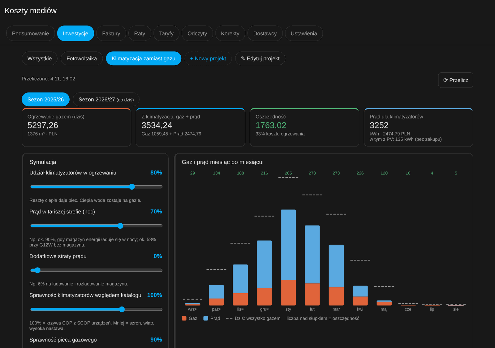
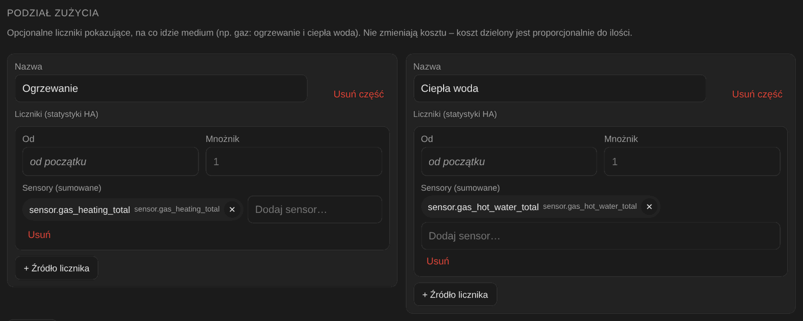
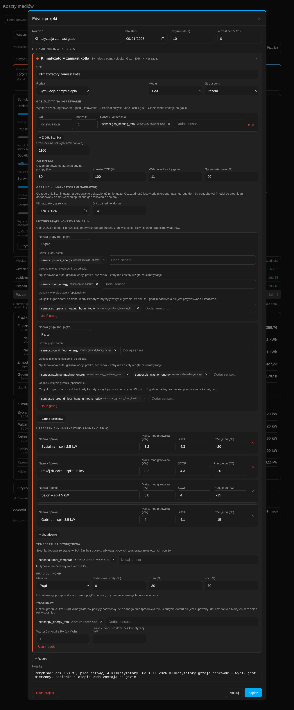
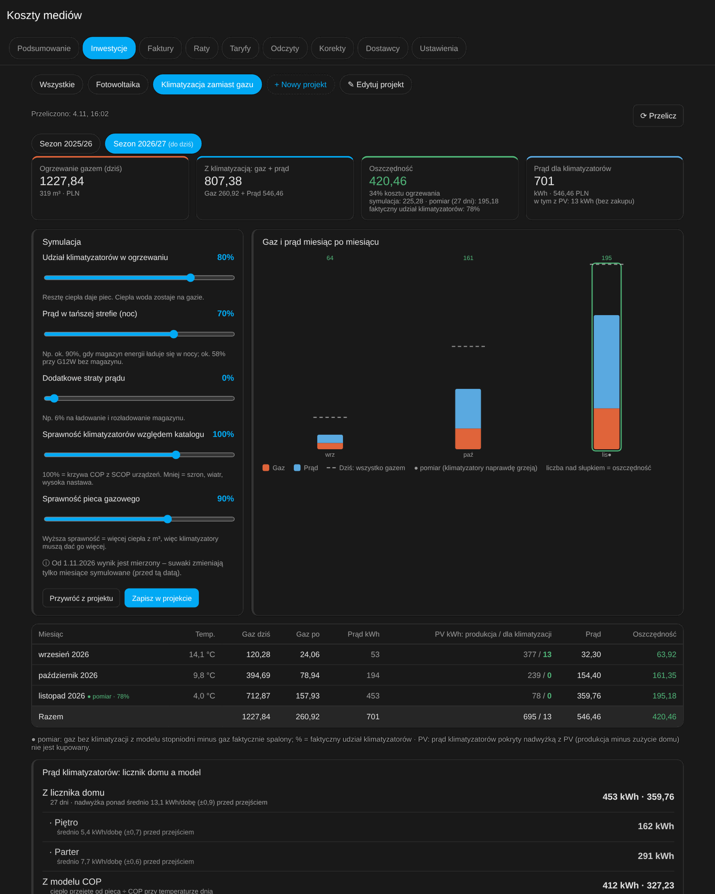
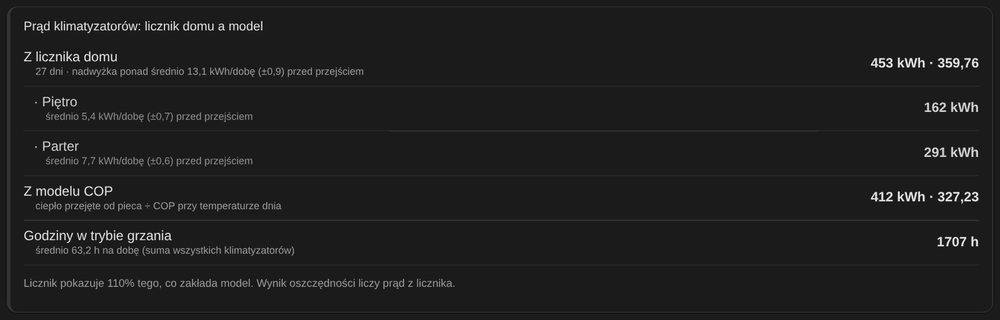
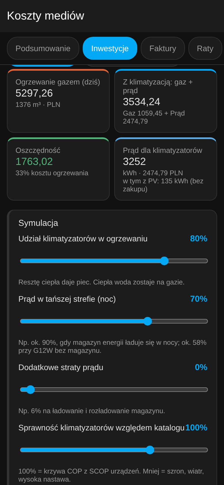

# Symulacja: pompy ciepła / klimatyzatory zamiast kotła gazowego

[English version](../heat-pump-simulation.md) · [← README](../../README.pl.md)

Ten poradnik prowadzi przez całe wdrożenie krok po kroku, od czujników w Home Assistant do gotowego widoku
w zakładce **Inwestycje**. Wszystkie nazwy czujników i liczby pochodzą z **fikcyjnego domu przykładowego**.
Podmień je na swoje.

<p align="center"></p>

## Co to liczy

Pytanie brzmi: *ile zaoszczędzę, jeśli część ciepła, które dziś daje kocioł gazowy, przejmą klimatyzatory lub
pompy ciepła powietrze–powietrze?*

Symulacja liczy każdy dzień osobno:

1. **Ciepło z kotła** = gaz na ogrzewanie × kWh na m³ (np. 11) × sprawność kotła (np. 90%).
2. Wybrany **udział** tego ciepła (np. 80%) przejmują urządzenia, każde proporcjonalnie do swojej mocy.
   Urządzenie przestaje grzać, gdy temperatura spadnie poniżej jego minimum (np. −15 °C), a jedno urządzenie
   nie da więcej niż moc × 24 h.
3. **Prąd** = przejęte ciepło ÷ COP. COP zależy od temperatury na zewnątrz w danym dniu i od SCOP urządzenia.
4. **Wynik** = niespalony gaz × cena gazu − prąd × cena prądu. Cena prądu uwzględnia podział na strefy taryfy,
   np. 70% noc i 30% dzień.

5. **Własne PV (opcjonalnie):** prąd klimatyzatorów pokryty nadwyżką z PV nie jest kupowany. Nadwyżka to
   produkcja dnia minus zużycie domu bez klimatyzatorów. W dniach bez danych z PV brana jest produkcja z tego
   samego dnia rok wcześniej (w tabeli oznaczenie ↺).

Ciepła woda i opłata stała za gaz zostają bez zmian, bo kocioł dalej grzeje wodę.

Po dacie **„Klimatyzatory grzeją od”** wynik przestaje być symulacją i staje się **pomiarem**:

- *gaz bez klimatyzatorów* pochodzi z modelu stopniodni, dopasowanego do dni sprzed tej daty:
  `gaz/dobę = k × max(0, 15 °C − T)`;
- *zaoszczędzony gaz* to ta wartość minus gaz faktycznie spalony (z licznika na ogrzewanie);
- *prąd klimatyzatorów* pochodzi z licznika domu: nadwyżka ponad średnie zużycie sprzed przejścia, po odjęciu
  osobno mierzonych odbiorników. Gdy licznika domu nie ma, prąd jest liczony z modelu COP.

## Czego potrzebujesz

| # | Dane | Po co | Wymagane? |
|---|---|---|---|
| A | Gaz zużyty **na ogrzewanie** (licznik `total_increasing`, m³) | podstawa całego wyliczenia | tak (albo sam licznik gazu + szacunek) |
| B | Temperatura zewnętrzna (`state_class: measurement`, °C) | COP i model stopniodni | zalecane |
| C | Taryfy gazu i prądu w zakładce **Taryfy** | ceny | tak |
| D | Licznik prądu domu, najlepiej osobno dla pięter (`total_increasing`, kWh) | prąd klimatyzatorów w okresie pomiaru | opcjonalne |
| E | Liczniki odbiorników do odjęcia: pralka, suszarka, zmywarka… | mniej szumu w pomiarze | opcjonalne |
| F | Godziny pracy klimatyzatorów w trybie grzania na dobę | dzień bez grzania = brak prądu klimatyzatorów | opcjonalne |
| G | Licznik produkcji PV (`total_increasing`, kWh) | część prądu klimatyzatorów za darmo | opcjonalne |

Integracja czyta wyłącznie **statystyki długoterminowe** HA. Czujnik bez `state_class` nie trafi do statystyk,
a recorder trzyma zwykłą historię tylko kilka dni. Dlatego wszystkie czujniki poniżej mają ustawione `state_class`.

---

## Krok A: gaz na ogrzewanie i na ciepłą wodę

Masz osobny licznik gazu na ogrzewanie? Pomiń ten krok. Jeśli nie, rozdziel licznik całkowity według tego, co
w danej chwili robi kocioł. Większość integracji kotłów (OpenTherm, ems-esp, ebusd, Viessmann, De Dietrich…)
udostępnia status albo tryb pracy.

W domu przykładowym:

- `sensor.gas_meter`: licznik gazu w m³, rośnie co 0,01 m³;
- `sensor.boiler_status`: status kotła ze stanami `heating`, `hot_water` i `idle`.

Dodaj do `configuration.yaml` (albo do pliku dołączonego jako `template: !include template.yaml`):

```yaml
template:
  # Ostatni aktywny tryb kotła, potrzebny, gdy gaz dolicza się, zanim status się zmieni
  - trigger:
      - trigger: state
        entity_id: sensor.boiler_status
        not_to: [unavailable, unknown]
    sensor:
      - name: Boiler last active mode
        unique_id: boiler_last_active_mode
        state: >
          
          heatinghot_water{{ this.state }}

  # Każdy przyrost licznika gazu trafia do ogrzewania albo do ciepłej wody
  - trigger:
      - trigger: state
        entity_id: sensor.gas_meter
        not_to: [unavailable, unknown]
        not_from: [unavailable, unknown]
    sensor:
      - name: Gas heating total
        unique_id: gas_heating_total
        unit_of_measurement: "m³"
        device_class: gas
        state_class: total_increasing
        state: >
          
          
          
          {{ (this.state|float(0) + (d if 0 < d < 1 and mode == 'heating' else 0))|round(3) }}
      - name: Gas hot water total
        unique_id: gas_hot_water_total
        unit_of_measurement: "m³"
        device_class: gas
        state_class: total_increasing
        state: >
          
          
          
          {{ (this.state|float(0) + (d if 0 < d < 1 and mode == 'hot_water' else 0))|round(3) }}
```

- **Inne stany kotła:** jeśli Twój kocioł podaje np. `3:Ogrzewanie CO` i `4:Ogrzewanie CWU`, zamień warunki na
  `s.startswith('3')` i `s.startswith('4')`.
- **Filtr `0 < d < 1`:** pomija wymianę licznika i jego restart.
- **Po zapisie:** **Narzędzia deweloperskie → YAML → Szablony: Przeładuj**. Restart nie jest potrzebny.

Potem w panelu **Koszty mediów → Ustawienia → Gaz → Podział zużycia** dodaj dwie części:

<p align="center"></p>

Nowe czujniki nie mają historii wstecz. Dni sprzed ich powstania symulacja liczy z pola
**Szacunek na rok (gdy brak danych)**, rozkładając go według stopniodni. Wystarczy tam wpisać gaz na ogrzewanie
z ostatniego rozliczenia, np. 1100 m³.

## Krok B: temperatura zewnętrzna

Wystarczy dowolny czujnik z `device_class: temperature` i `state_class: measurement`: stacja pogodowa, czujnik
zewnętrzny kotła albo czujnik Zigbee za oknem. W domu przykładowym to `sensor.outdoor_temperature`.

Dni bez odczytu, np. sprzed instalacji czujnika, przyjmują **typowe temperatury miesięczne**. Domyślnie to
średnie z lat 1991–2020 dla Polski południowej, a w regule możesz wpisać własne.

## Krok C: taryfy

W zakładce **Taryfy** muszą być taryfy gazu i prądu na cały okres projektu. Gdy medium ma strefy, np. dzień
i noc, w regule podasz, jaka część energii klimatyzatorów przypada na każdą z nich.

## Krok D–F: pomiar po przejściu (opcjonalnie)

Wystarczy, jeśli chcesz tylko zasymulować. Gdy zaczniesz naprawdę grzać klimatyzatorami, zrób te kroki
**najlepiej 2 tygodnie wcześniej**, żeby była średnia zużycia domu sprzed przejścia.

**D: licznik domu.** Dowolny licznik energii `total_increasing` w kWh, np. Shelly EM na zasilaniu piętra, licznik
falownika albo Shelly 3EM. Jeśli masz osobne liczniki pięter, użyj ich jako osobnych **grup**. Każda grupa ma
wtedy własną średnią i własne godziny grzania, więc pranie na parterze nie zostanie wzięte za klimatyzator na
piętrze. Dom przykładowy:

| Grupa | Licznik | Odejmowane | Godziny grzania |
|---|---|---|---|
| Piętro | `sensor.upstairs_energy` | `sensor.dryer_energy` | `sensor.ac_upstairs_heating_hours_today` |
| Parter | `sensor.ground_floor_energy` | `sensor.washing_machine_energy`, `sensor.dishwasher_energy` | `sensor.ac_ground_floor_heating_hours_today` |

**E: odbiorniki do odjęcia.** Liczniki energii urządzeń, które mocno wahają się z dnia na dzień: pralka,
suszarka, zmywarka, grzałka wody. Lodówki odejmować nie trzeba. Odejmuj tylko to, co **faktycznie jest za
licznikiem** danej grupy. Np. ładowarka auta zasilana bezpośrednio z sieci, poza licznikiem domu, **nie** może
być odejmowana.

**F: godziny w trybie grzania.** Dla każdego klimatyzatora utwórz pomocnika **Statystyki historii**
(*Ustawienia → Urządzenia i usługi → Pomocnicy → Utwórz pomocnika → History stats*):

| Pole | Wartość |
|---|---|
| Encja | `climate.living_room_ac` |
| Stan | `heat` |
| Typ | Czas |
| Początek | `{{ today_at() }}` |
| Koniec | `{{ now() }}` |

Pomocnik History stats **nie zapisuje statystyk długoterminowych**. Dlatego zsumuj godziny w **pomocniku
szablonowym** (*Pomocnicy → Szablon → Czujnik*), osobno dla każdej grupy:

| Pole | Wartość |
|---|---|
| Stan | `{{ (['sensor.living_room_ac_heating_today', 'sensor.office_ac_heating_today'] \| map('states') \| map('float', 0) \| sum) \| round(2) }}` |
| Jednostka | `h` |
| Klasa urządzenia | Czas trwania |
| Klasa stanu | **Pomiar** |

Integracja bierze z niego **maksimum doby**, czyli liczbę godzin z danego dnia. Stan `heat` oznacza ustawiony
tryb, a nie ciągłą pracę sprężarki. Dlatego godziny służą tylko jako filtr: w dniu z 0 godzin nadwyżka zużycia
nie jest przypisywana klimatyzacji.

**Pomiar liczy tylko pełne doby.** Bieżący dzień wchodzi do pomiaru dopiero następnego dnia. Dzień przejścia
jest mieszany (rano piec, wieczorem klimatyzatory), więc jako datę przejścia najlepiej podać dzień następny.
Faktyczny udział klimatyzatorów pokazuje się od 3 pełnych dni pomiaru.

## Krok PV: własna fotowoltaika (opcjonalnie)

Wskaż licznik produkcji PV, np. `sensor.pv_energy_total` (`total_increasing`, kWh). Dla każdego dnia:

- nadwyżka PV = produkcja − zużycie domu bez klimatyzatorów. Zużycie bierzemy z liczników grup z kroku D,
  a gdy ich nie ma, z pola **Zużycie domu na dobę bez klimatyzacji**;
- prąd klimatyzatorów do wysokości nadwyżki nie jest kupowany. Wycenia go pole **Wartość energii z PV**:
  0 oznacza energię darmową, a cenę wpisz, gdy nadwyżkę możesz sprzedać.

Zimą nadwyżki zwykle nie ma, bo PV produkuje mało, a dom zużywa swoje. PV robi różnicę głównie we wrześniu,
październiku, marcu i kwietniu. Tabela miesięcy pokazuje produkcję PV i ile z niej poszło na klimatyzatory.

---

## Krok G: projekt w panelu

**Koszty mediów → Inwestycje → + Nowy projekt → szablon „Pompa ciepła zamiast gazu”.**
Szablon sam podpina część „Ogrzewanie” gazu i czujnik temperatury, jeśli je znajdzie. Uzupełnij resztę:

<p align="center"></p>

| Pole | Dom przykładowy | Uwagi |
|---|---|---|
| Data startu | 2025-09-01 | początek sezonu, który chcesz zobaczyć |
| Gaz zużyty na ogrzewanie | `sensor.gas_heating_total` | część „Ogrzewanie” z kroku A |
| Szacunek na rok | 1100 | m³ na ogrzewanie dla dni bez danych |
| Udział ogrzewania przeniesiony na pompy | 80 % | resztę daje piec, np. łazienki z podłogówką |
| Korekta COP | 100 % | mniej, gdy urządzenia stoją w złym miejscu albo szronią |
| kWh na jednostkę gazu / sprawność kotła | 11 / 90 % | z faktury dostawcy gazu |
| Urządzenia | 4 klimatyzatory: moc maks. 3,2–5,8 kW, SCOP 4,0–4,3, pracują do −15…−20 °C | dane z karty katalogowej (moc grzewcza maks.) |
| Temperatura zewnętrzna | `sensor.outdoor_temperature` | krok B |
| Prąd dla pomp | medium Prąd, noc 70 % / dzień 30 %, straty 0 % | np. noc 90 % i straty 6 %, gdy prąd idzie przez magazyn energii |
| Własne PV | `sensor.pv_energy_total`, wartość 0 | krok PV |
| Klimatyzatory grzeją od | 2026-11-01 | puste = tylko symulacja; najlepiej dzień po faktycznym przejściu |
| Liczniki prądu (grupy) | Piętro, Parter (tabela w kroku D) | opcjonalne |

Wydatki dodajesz w sekcji **Wydatki** pod widokiem, np. zakup i montaż. Bez wydatków projekt pokazuje samą
oszczędność.

## Jak czytać wyniki

**Sezon (wrzesień–sierpień):**
- *Ogrzewanie gazem (dziś)*: koszt ogrzewania, gdyby wszystko dalej grzał piec.
- *Z klimatyzacją: gaz + prąd*: koszt gazu, który zostaje, plus koszt prądu dla klimatyzatorów.
- *Oszczędność*: różnica tych dwóch kwot.

Gdy sezon ma oba okresy, kafelek oszczędności pokazuje osobno część symulowaną i zmierzoną, np.
„symulacja: 225 · pomiar (27 dni): 195”.

**Suwaki** zmieniają wynik od razu, ale tylko w części symulowanej. **Zapisz w projekcie** utrwala wybrane ustawienia.

**Wykres:** pomarańczowe słupki to gaz, który zostaje, niebieskie to prąd, a przerywana linia to koszt
„wszystko gazem”. Liczba nad słupkiem to oszczędność danego miesiąca.

**Oznaczenia w tabeli:** ≈ to miesiąc szacowany (brak danych gazu), * to temperatura typowa, a ● to pomiar.

<p align="center"></p>

**Okres pomiaru:** miesiące po dacie przejścia mają znacznik ● z faktycznym udziałem klimatyzatorów. Karta
**Prąd klimatyzatorów: licznik domu a model** pokazuje prąd z licznika (z podziałem na grupy) obok prądu z modelu
COP. Gdy licznik pokazuje znacznie więcej niż model, klimatyzatory pracują gorzej niż zakłada katalog. Wtedy
obniż **Korektę COP**, żeby kolejne symulacje były bliższe rzeczywistości.

<p align="center"></p>

Na telefonie widok jest w jednej kolumnie:

<p align="center"></p>

## Pytania i pułapki

- **Dodanie urządzenia prawie nie zmienia wyniku.** To celowe. Wynik zależy od **udziału**, a urządzenia dzielą
  między siebie ciepło według mocy. Więcej urządzeń poprawia COP i wydłużają pracę w mrozy, ale nie zwiększają
  udziału. Udział ustaw realnie: pomieszczenia bez klimatyzatora, np. łazienki, zostają na piecu.
- **Model stopniodni z małej liczby dni** jest przybliżony. Z każdym tygodniem przed datą przejścia jest dokładniejszy.
- **Dzień przejścia jest mieszany.** Jako datę najlepiej podać następny dzień.
- **Pomiar prądu ma szum dzienny,** czyli rozrzut średniej (± w karcie porównania). Patrz na tydzień i miesiąc,
  nie na pojedynczy dzień.
- **Klimatyzatory, które grzały już wcześniej,** obniżają zapotrzebowanie zapisane w liczniku gazu. Symulacja
  może wtedy lekko zawyżać oszczędność.
- **Pomieszczenia grzane dotąd tylko „przy okazji”,** np. garaż przy podłogówce, liczą się do ogrzewania gazem.
  Klimatyzator w takim pomieszczeniu dodaj do urządzeń.
- **Restart:** wszystko z tego poradnika działa bez restartu HA. Szablony przeładowujesz, a pomocników tworzysz
  w UI.
